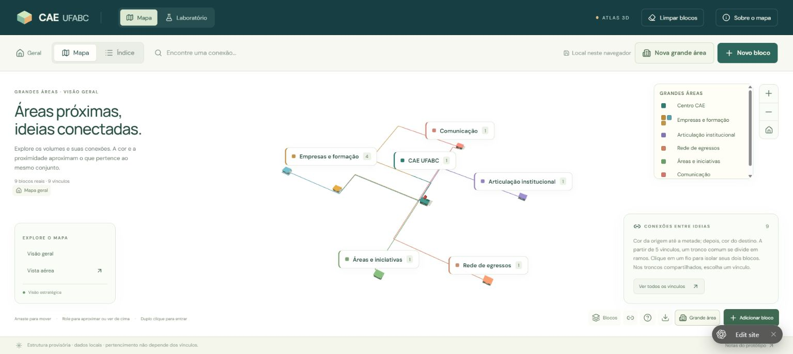
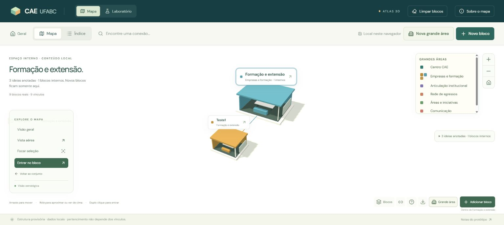

# CAE · Spatial dashboard

**In development** 
Platform created: November 9, 2026 · Last recorded update: November 12, 2026 
Presentation updated on November 17, 2026.

**A visual dashboard that uses space to organize ideas, projects and their relationships.**

I created this project for CAE to explore a visual way of organizing events, commitments, people and initiatives. The idea is to locate an area of work, move closer to it and understand how its parts connect to the whole.

[Português](README.md) · [Portfolio](https://github.com/EagleKhan0505)

*Captured on November 17, 2026. The blocks represent a provisional structure; displayed connections are not evidence of institutional partnerships or confirmed schedules.*

## A map you can enter

The atlas represents areas and initiatives as volumes in a 3D environment. Color, proximity and connections help explain the structure. Navigation allows zooming, changing perspective and entering a block to explore its content and nested blocks.

Labels follow the level of detail: the overview emphasizes major areas, while exploring a space reveals local content. Search, an index and relationship lists provide other ways to find information.

*The same platform after entering Formação e extensão. “Teste1” is a visible test record, not a completed institutional project.*

## Organizing the work behind the map

Alongside the atlas, an organization laboratory contains projects, tasks, owners recorded as labels, deadlines, notes and decisions. Tasks can be viewed as a list, Kanban board or calendar. These are complementary views; they do not mean every record is automatically placed on the 3D map.

The distinction between **belonging to a space** and **connecting to another space** shaped the implementation. An initiative can remain in its home area while relating to several others. Editing relationships preserves that home context. Moving the camera changes the view without rewriting the underlying organization.

## Current implementation

This is an evolving functional prototype with spatial navigation, block creation, hierarchy, relationship editing and local organization. Records are saved in the browser, with export, import and recovery features. Cross-device synchronization and real team authorization are not established capabilities of this version.

**Built with:** React/TypeScript and Three.js, using AI-assisted development. My direction is to explore how spatial interfaces can make organization more intuitive, refining navigation, label readability and the transition from overview to detail.

This repository contains a project overview and actual platform captures. The complete application and working data remain private.
