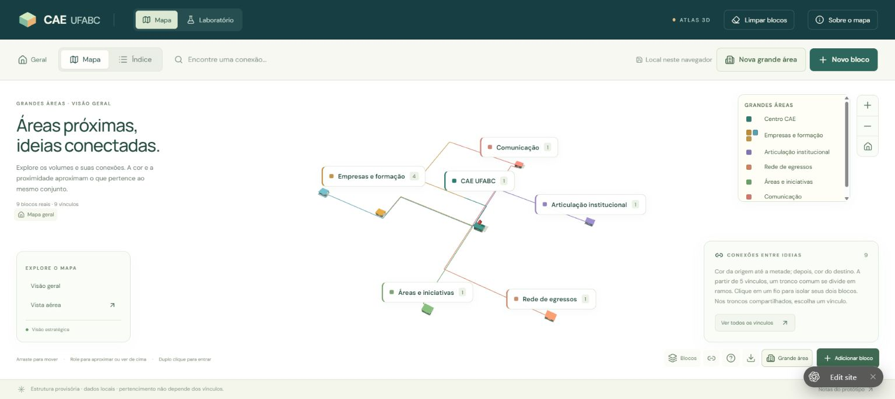
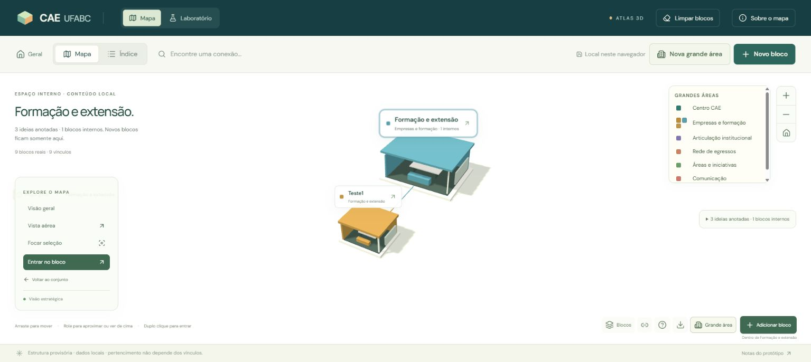

# CAE · Dashboard espacial

**Um dashboard visual que usa o espaço para organizar ideias, projetos e as relações entre eles.**

Criei este projeto para o CAE pensando em uma forma de ordenar eventos, compromissos, pessoas e iniciativas que fizesse sentido visualmente. A proposta é poder localizar uma área de atuação, aproximar-se dela e entender como cada parte se conecta ao conjunto.

[English](README.en.md) · [Portfólio](https://github.com/EagleKhan0505)

*Captura da plataforma em 17/11/2026. Os blocos representam uma estrutura provisória; os vínculos exibidos não comprovam parcerias ou agendas institucionais.*

## Um mapa em que se pode entrar

O atlas apresenta áreas e iniciativas como volumes em um ambiente 3D. Cor, proximidade e conexões ajudam a ler o conjunto. A navegação permite aproximar, mudar a perspectiva e entrar em um bloco para explorar seu conteúdo e seus blocos internos.

Os rótulos acompanham o nível de detalhe da visualização. Na visão geral, o foco está nas grandes áreas; ao explorar um espaço, o conteúdo local ganha destaque. Há também busca, índice e listas de vínculos, para que encontrar uma informação não dependa apenas de navegar pelo desenho.

*A mesma plataforma após entrar em Formação e extensão. “Teste1” é um registro de teste visível na captura, não um projeto institucional apresentado como realizado.*

## Organizar o trabalho, além de visualizar

A plataforma reúne o atlas e um laboratório de organização com projetos, tarefas, responsáveis registrados como rótulos, prazos, notas e decisões. As tarefas podem ser vistas em lista, Kanban ou calendário. Essas são formas complementares de consultar e organizar o trabalho; não significam que todos os registros já sejam posicionados automaticamente no mapa 3D.

A distinção entre **pertencer a um espaço** e **ter uma conexão com outro** orientou a implementação. Uma iniciativa pode continuar dentro da sua área e se relacionar com várias outras. Criar ou editar esses vínculos preserva seu contexto de origem. Da mesma forma, mover a câmera muda a visualização, sem reescrever a organização dos registros.

## O que existe hoje

É um protótipo funcional em evolução, com navegação espacial, criação de blocos, hierarquia, edição de vínculos e organização local. O salvamento ocorre no navegador, com exportação, importação e recursos de recuperação. Sincronização entre dispositivos e gestão real de permissões de equipe não são resultados comprovados desta versão.

**Construção:** React/TypeScript e Three.js, com desenvolvimento assistido por IA. Minha direção no projeto é explorar como uma interface espacial pode tornar a organização mais intuitiva, refinando o mapa, a leitura dos rótulos e a relação entre visão geral e detalhe.

Este repositório apresenta o conceito e capturas reais da plataforma. O aplicativo completo e os dados de trabalho permanecem privados.
